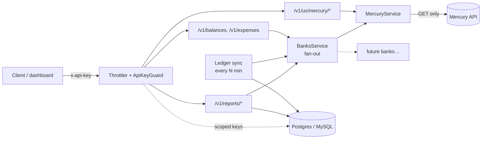

# finops-api

A bank-agnostic, **read-only** finance and FinOps aggregator built with NestJS.
Connect one or more banks, deploy it anywhere, plug in your own credentials and (optionally) your own database, and get one API for balances, expenses and reports.

- **Read-only by design.** No integration exposes anything that moves money. Mercury access is limited to **balances and expenses**.
- **Bank-agnostic.** Each bank implements one small contract. Aggregates, sync and reports work for every bank automatically.
- **Organized by country and bank.** Routes look like `/v1/{country}/{bank}/...`, e.g. `/v1/us/mercury/balances`.
- **DB optional.** The app runs without a database. Set `DATABASE_URL` to enable the ledger, reports and scoped API keys.

| | Status |
|---|---|
| 🇺🇸 Mercury | ✅ balances, expenses |
| 🇦🇷 Argentina | ⏸ not started |

---

## Contents
- [Quick start](#quick-start)
- [API](#api)
- [Authentication and scopes](#authentication-and-scopes)
- [Configuration](#configuration)
- [Architecture](#architecture)
- [Database, ledger and reports](#database-ledger-and-reports)
- [Logging and audit](#logging-and-audit)
- [Security](#security)
- [Adding a bank](#adding-a-bank)
- [Testing](#testing)
- [Deployment](#deployment)
- [Known limits](#known-limits)
- [Roadmap](#roadmap)

---

## Quick start

Requires Node ≥ 22 and pnpm 10.

```bash
cp .env.example .env        # set API_KEYS and MERCURY_API_TOKEN
pnpm install
pnpm start:dev
```

```bash
curl -H 'x-api-key: change-me' localhost:3000/v1/balances
open http://localhost:3000/docs      # Swagger UI ("Authorize" → paste your key)
```

The OpenAPI JSON is served at `/docs-json`, so you can generate clients from it.

---

## API

All routes except `/health` require an `x-api-key` header.

### Aggregate (all configured banks)

| Method & path | Scope | Description |
|---|---|---|
| `GET /v1/balances` | `balances` | Every account at every bank, plus per-currency totals |
| `GET /v1/expenses?start&end` | `expenses` | Every expense across all banks in the range (live, fully paginated), plus per-currency totals |

Aggregate responses include an `errors` array. If one bank is down, the others are still returned:

```json
{
  "items": [{ "bank": "mercury", "country": "US", "accountId": "…", "name": "Checking", "currency": "USD", "available": 10000, "current": 10050.25, "status": "active" }],
  "totals": [{ "currency": "USD", "available": 10000, "current": 10050.25 }],
  "errors": []
}
```

### Per bank: 🇺🇸 Mercury

| Method & path | Scope | Description |
|---|---|---|
| `GET /v1/us/mercury/balances` | `balances` | All Mercury account balances |
| `GET /v1/us/mercury/accounts/:id/balance` | `balances` | One account |
| `GET /v1/us/mercury/accounts/:id/expenses?start&end&status&limit&offset` | `expenses` | One page of outgoing transactions |

### Reports and ledger (need a DB)

| Method & path | Scope | Description |
|---|---|---|
| `GET /v1/reports/burn?months=6` | `reports` | Monthly gross burn per currency (zero-filled) |
| `GET /v1/reports/runway` | `reports` | Live available balance ÷ average burn of the last 3 complete months |
| `GET /v1/reports/spend?groupBy=category\|counterparty\|bank\|kind\|accountId&start&end` | `reports` | Spend totals, largest first |
| `GET /v1/reports/expenses.csv?start&end` | `reports` | CSV export for accounting |
| `POST /v1/ledger/sync?start&end` | `admin` | Sync now, or backfill a range |

### Admin (needs a DB)

| Method & path | Scope | Description |
|---|---|---|
| `POST /v1/admin/api-keys` `{ name, scopes[] }` | `admin` | Create a scoped key (returned **once**) |
| `GET /v1/admin/api-keys` | `admin` | List active keys (no secrets) |
| `DELETE /v1/admin/api-keys/:id` | `admin` | Revoke |

### Other

| Method & path | Description |
|---|---|
| `GET /health` | Public. `{ status, db: "disabled" \| "up" \| "down" }` |
| `GET /docs` | Swagger UI |

**Conventions.** Amounts are in major units (dollars, not cents). Expense `amount` is positive and means money out. Dates accept `YYYY-MM-DD` or ISO 8601. A bare end date covers the whole day. The default range is the last 30 days.

**Errors.** `400` invalid input · `401` missing or invalid key · `403` key lacks the scope · `404` unknown account · `409` sync already running · `429` rate limited · `502` bank error or unreachable · `503` bank not configured.

---

## Authentication and scopes

There are two kinds of keys, both sent as `x-api-key`:

1. **Env keys** (`API_KEYS=k1,k2`) are always **admin**. Use them to bootstrap and for ops. Rotate them by redeploying.
2. **DB keys** (`fo_…`) are created with `POST /v1/admin/api-keys` and carry explicit scopes. Only a sha256 hash is stored, and the plaintext is shown once. Revoking takes effect immediately.

| Scope | Grants |
|---|---|
| `balances` | balance routes |
| `expenses` | expense routes |
| `reports` | reports and CSV |
| `admin` | everything, including key admin and manual sync |

Routes **default-deny**: a route without a declared scope requires `admin`.

```bash
curl -X POST localhost:3000/v1/admin/api-keys \
  -H 'x-api-key: <admin-key>' -H 'content-type: application/json' \
  -d '{"name":"grafana","scopes":["balances","reports"]}'
```

---

## Configuration

All configuration comes from environment variables (see `.env.example`).

| Variable | Default | Description |
|---|---|---|
| `PORT` | `3000` | HTTP port |
| `LOG_LEVEL` | `info` | pino level (`silent` … `trace`) |
| `API_KEYS` | **required** | Comma-separated admin keys |
| `MERCURY_API_TOKEN` | – | Mercury token **including** the `secret-token:` prefix. Leave unset to disable Mercury (routes return 503). |
| `MERCURY_BASE_URL` | `https://api.mercury.com/api/v1` | Use `https://api-sandbox.mercury.com/api/v1` for sandbox |
| `BALANCE_CACHE_SECONDS` | `30` | Per-instance balance cache; `0` disables it |
| `DATABASE_URL` | – | `postgres://` · `mysql://` · `mariadb://`. Unset means no DB. |
| `DATABASE_SSL` | – | `true` = verified TLS · `no-verify` = TLS without certificate check |
| `SYNC_INTERVAL_MINUTES` | `30` | Background ledger sync; `0` disables it |
| `SYNC_LOOKBACK_DAYS` | `30` | Window re-synced on each run (catches status changes such as pending → sent) |
| `SYNC_BACKFILL_DAYS` | `365` | Window for the first sync on an empty table |
| `ALERT_WEBHOOK_URL` | – | Slack-compatible webhook (`{"text": …}`). Each sync alerts on money out to counterparties never seen before (e.g. a fraudulent ACH debit). Always logged as a warning too. Skipped on the first backfill. For Telegram use `https://api.telegram.org/bot<TOKEN>/sendMessage`. |
| `ALERT_TELEGRAM_CHAT_ID` | – | Set it to send alerts to Telegram (adds `chat_id` to the payload) |

---

## Architecture



```
src/
├── main.ts / app.setup.ts     bootstrap, helmet, validation, Swagger (shared with e2e)
├── app.module.ts              config, logging, rate limit, guards, conditional DB
├── auth/                      API-key guard, scopes, key entity + admin endpoints
├── banks/
│   ├── bank-connector.ts      the contract every bank implements
│   ├── bank.dto.ts            normalized shapes (BalanceDto, ExpenseDto, …)
│   ├── banks.service.ts       fan-out aggregator with partial-failure handling
│   └── us/mercury/            Mercury connector + per-bank routes
├── ledger/                    expense entity, sync job, reports, CSV
├── database/                  TypeORM setup + migrations (DB-agnostic)
└── common/                    money math, TTL cache, CSV writer
```

**Key decisions**
- **One contract per bank (`BankConnector`)**: `balances()`, `allExpenses(range)`, `isConfigured()`, and deliberately nothing that moves money.
- **Normalized DTOs.** Clients never see a bank's raw schema, so switching or adding banks doesn't break them.
- **Partial failure over all-or-nothing.** The aggregator uses `Promise.allSettled` and reports per-bank errors.
- **Money math in integer cents.** Totals never show float drift.
- **The DB is a conditional module.** No `DATABASE_URL` means TypeORM is never loaded.

---

## Database, ledger and reports

- **Engines:** Postgres (`pg`), MySQL and MariaDB (`mysql2`). Both drivers are installed. Migrations use TypeORM's Table API, so one migration works on all three.
- **Migrations run on boot.** `synchronize` is off, so the ORM never alters schema on its own.
- **Tables:** `api_keys`, `expenses`, plus TypeORM's `migrations`.
- **The ledger stores expenses only**, never income, to match the read-only "balances + expenses" scope.
- **Sync** is idempotent. The primary key is `${bank}:${externalId}`, and rows are upserted in chunks of 500. Only one sync runs per instance at a time, and a manual sync during a run returns `409`.
- **Reports:**
  - *Burn* is gross (expenses with status `sent` or `pending`) per calendar month (UTC).
  - *Runway* is the live available balance ÷ average burn of the last 3 **complete** months, or `null` with no burn.
  - *Spend* groups by a dimension; a missing value is grouped as `(none)`.
  - *CSV* follows RFC 4180, and cells starting with `= + - @` are prefixed with `'` to prevent spreadsheet formula injection.

---

## Logging and audit

- Logs are structured JSON (pino), one line per request.
- **Request ID:** taken from the caller's `x-request-id` if it is safe (`[\w-]{1,64}`), otherwise generated. It is echoed back in the response header.
- **Audit:** each request line carries `apiKey`, the name of the calling key (`env-0`, `grafana`, …).
- **Redaction:** `authorization`, `x-api-key` and `cookie` headers are logged as `[Redacted]`.
- For pretty output locally: `pnpm start:dev | pnpm dlx pino-pretty`

---

## Security

**In the app**
- Mercury calls are GET-only, with a 15s timeout. Upstream error bodies are logged but never returned to clients.
- Account IDs are validated as UUIDs before they are put into upstream URLs. All query and body input is validated, and unknown fields are rejected.
- Env keys are compared in constant time over sha256 digests. DB keys are 192-bit random values, stored hashed, and shown once.
- Helmet headers are set, and there is a rate limit of 60 requests per minute per IP.

**In the Mercury dashboard (do this before production)**
1. Create a **read-only** API token.
2. Add your deployment's egress IPs to the token's **IP whitelist**. This needs static egress; most PaaS providers sell it as an add-on.
3. Develop against the **sandbox** (`MERCURY_BASE_URL=https://api-sandbox.mercury.com/api/v1`).

**Secrets**: keep them in your platform's secret store. `.env*` files are git- and docker-ignored, except `.env.example`.

---

## Adding a bank

1. Create `src/banks/<country>/<bank>/` with a service implementing `BankConnector` (map the bank's data to `BalanceDto` / `ExpenseDto`) and, optionally, a controller for per-bank routes under `<country>/<bank>`.
2. Register it in `BANK_CONNECTORS` in `src/banks/banks.module.ts`.
3. Read its credentials from env, and return `false` from `isConfigured()` when they are missing.

Aggregates, sync, reports and Swagger pick the new bank up automatically. Use `src/banks/us/mercury/` as the reference implementation.

---

## Testing

```bash
pnpm test            # unit
pnpm test:e2e        # e2e: auth, validation, health, OpenAPI
```

The e2e suite enables more paths depending on the environment:

| Env | Adds |
|---|---|
| `MERCURY_API_TOKEN` (+ `MERCURY_BASE_URL`) | live balance and expense calls |
| `DATABASE_URL` | migrations, scoped keys, revocation, sync, reports, CSV |

A local Mercury stand-in is included:

```bash
node test/mock-mercury.mjs &
MERCURY_API_TOKEN=secret-token:mock MERCURY_BASE_URL=http://127.0.0.1:4010/api/v1 \
DATABASE_URL=postgres://postgres:p@localhost:5432/postgres pnpm test:e2e
```

**CI** (`.github/workflows/ci.yml`) runs lint, unit tests, build, e2e without a DB, e2e on Postgres with the mock Mercury, and a Docker build. It also runs e2e against the Mercury sandbox when the `MERCURY_SANDBOX_TOKEN` repository secret is set.

---

## Deployment

```bash
docker build -t finops-api .
docker run --env-file .env -p 3000:3000 finops-api
```

The image is multi-stage on `node:22-alpine`, contains production dependencies only, and runs as a non-root user. Point your platform's health check at `GET /health`.

---

## Known limits

| Limit | Upgrade path |
|---|---|
| Rate limit and balance cache are in memory, per instance | Redis-backed throttler and cache when running replicas |
| Each replica runs its own background sync (harmless: upserts are idempotent) | A single scheduled job or leader lock if bank quotas get tight |
| Reports aggregate in memory (fine to about 100k expenses) | Per-driver SQL `GROUP BY` |
| Per-currency totals only, no FX conversion | Arrives with the first non-USD bank (needs an ARS rate decision: official / MEP / blue) |
| Scopes are per capability, not per bank or country | Add `balances:us`-style scopes if needed |
| Mercury's docs don't state the sign of `amount`; negative is treated as money out | Verify against the sandbox |

## Roadmap
- 🇦🇷 Argentina banks
- FX conversion for cross-currency totals
- More banks and FinOps sources behind the same `BankConnector` contract
